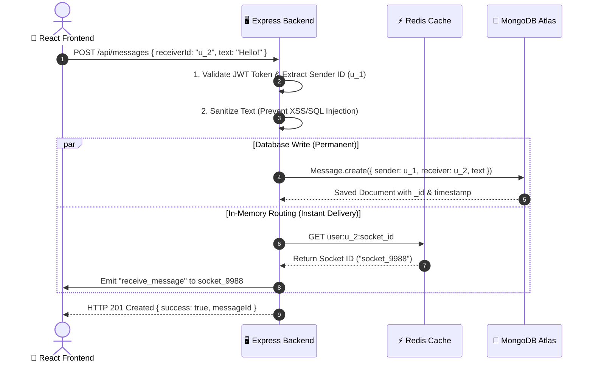
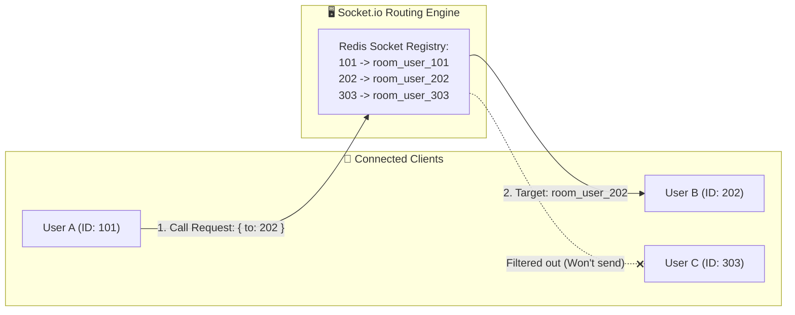
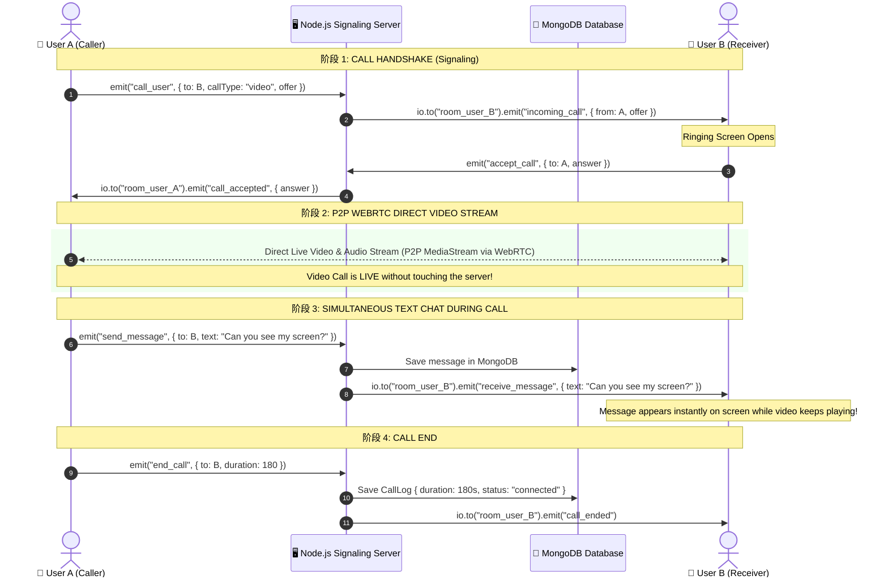

# 🚀 SOCIAL CONNECT — Enterprise Cloud Backend & Database Architecture

> **Project:** Social Connect (Social Discovery, Instant Messaging & WebRTC Video Calling Platform)  
> **Backend Architecture:** Production-Grade Node.js + Express.js + MongoDB Atlas (NoSQL) + Redis Cache + Socket.io + WebRTC (STUN/TURN)  
> **Document Purpose:** Complete Future-Ready Backend Guide, Cloud Database Internals, Real-Time Routing Logic, and Viva/Interview Explanation in Hinglish & English.

---

## 📌 Table of Contents

1. [🌟 Future-Ready Architecture Overview](#1-future-ready-architecture-overview)
2. [🗄️ Database Deep Dive: MongoDB Atlas & Redis Cache](#2-database-deep-dive-mongodb-atlas--redis-cache)
3. [🔄 Database ke Andar Data Kaise Process aur Handle Hota Hai?](#3-database-ke-andar-data-kaise-process-aur-handle-hota-hai)
4. [📊 Complete Production Database Schemas (Mongoose Models)](#4-complete-production-database-schemas-mongoose-models)
5. [🎯 The Routing Engine: Video Call + Instant Message "Sahi Direction" me Kaise Jate Hain?](#5-the-routing-engine-video-call--instant-message-sahi-direction-me-kaise-jate-hain)
6. [📞 Simultaneous Video Call & Chat: WebRTC + Socket.io Lifecycle](#6-simultaneous-video-call--chat-webrtc--socketio-lifecycle)
7. [🔌 Production REST API Endpoints & JWT Security](#7-production-rest-api-endpoints--jwt-security)
8. [💻 Ready-to-Use Production Codebase Structure](#8-ready-to-use-production-codebase-structure)
9. [🗣️ Viva & Interview Explanation Guide (Full Hinglish Scripts)](#9-viva--interview-explanation-guide-full-hinglish-scripts)
10. [❓ Top 15 Backend & Cloud Database Viva Q&A](#10-top-15-backend--cloud-database-viva-qa)

---

## 1. 🌟 Future-Ready Architecture Overview

Social Connect ko future me enterprise level (millions of users) par scale karne ke liye hum **3-Tier Cloud Micro-Service Architecture** use karte hain:

```mermaid
graph TD
    UserA["📱 User A (Device 1)"]
    UserB["💻 User B (Device 2)"]

    subgraph API_Gateway ["🌐 Load Balancer & API Gateway (Nginx / Cloudflare)"]
        Gateway["Reverse Proxy & SSL Termination"]
    end

    subgraph Backend_Cluster ["🖥️ Node.js + Express Server Cluster"]
        REST["REST API Server (Auth, Profile, Payments)"]
        SocketServer["Socket.io Real-Time Engine (Presence, Chat, Signaling)"]
    end

    subgraph Cache_Layer ["⚡ Fast Memory Layer"]
        Redis[("Redis In-Memory Store: Online Users, Active Sockets & Call Rooms")]
    end

    subgraph Database_Cluster ["💾 Primary Cloud Database"]
        MongoDB[("🍃 MongoDB Atlas Replica Set: Users, Messages, Call Logs, Feeds")]
    end

    subgraph Media_Cloud ["☁️ Media & Storage Cloud"]
        S3["AWS S3 / Cloudinary: Photos, Avatars & Private Albums"]
        TurnServer["Coturn (STUN / TURN Server for WebRTC NAT Traversal)"]
    end

    UserA <-->|HTTPS / WSS| Gateway
    UserB <-->|HTTPS / WSS| Gateway
    Gateway <--> REST
    Gateway <--> SocketServer

    REST <--> MongoDB
    REST <--> S3
    SocketServer <--> Redis
    SocketServer <--> MongoDB

    UserA -.->|P2P WebRTC Video & Audio Stream| UserB
    UserA -.->|Relay fallback if strict NAT| TurnServer
    UserB -.->|Relay fallback if strict NAT| TurnServer
```



### Is Architecture ka Fayda:
1. **Zero Data Loss:** Saara critical data cloud database (MongoDB) me encrypted aur replica-set ke sath save hota hai.
2. **Sub-50ms Real-Time Latency:** Chat aur call signals WebSocket aur Redis ke through travel karte hain.
3. **High Security:** Passwords **bcrypt** se hash hote hain, API requests **JWT (JSON Web Tokens)** se authenticate hoti hain.
4. **P2P Video Calling:** Server par heavy video bandwidth ka load nahi padta kyunki video direct user-to-user stream hoti hai.

---

## 2. 🗄️ Database Deep Dive: MongoDB Atlas & Redis Cache

Future enterprise architecture me hum **2 Databases ka Combination** use karte hain:

### A. Primary Database: MongoDB Atlas (Cloud NoSQL)
* **Kyu choose kiya?**
  - **Document Oriented (BSON/JSON):** Social media profiles me dynamic data hota hai (interests array, photo albums, multiple social links). SQL me multiple foreign keys lagti hain, jabki MongoDB me single user document me nested data cleanly store ho jata hai.
  - **High Write Throughput:** Chat messages aur likes seconds me hazaron aate hain. MongoDB rapid write operations ke liye best hai.
  - **Automatic Sharding & Replication:** Future me 10 lakh users aane par MongoDB Atlas automatic partitions (shards) bana deta hai.

### B. In-Memory Cache Database: Redis
* **Kyu choose kiya?**
  - MongoDB disk par likhta hai, jabki **Redis RAM (Memory) me kaam karta hai (Microsecond speed)**.
  - **Online Status Tracking:** Kaunsa user abhi online hai aur kis socket ID se juda hai, ye Redis me store hota hai (`SET user:123:socket "sock_abc987"`).
  - **Typing Indicators & Active Call Sessions:** In temporary states ko disk par save karne ki zarurat nahi hoti; Redis automatically expire kar deta hai (TTL).

### C. Media Storage: AWS S3 / Cloudinary
* Database me kabhi bhi badi image files ya video files store nahi karni chahiye (isse database slow ho jata hai).
* Photos **AWS S3 bucket** ya **Cloudinary CDN** par upload hoti hain, aur database me sirf uska **Secure CDN URL** (`https://res.cloudinary.com/...`) save hota hai.

---

## 3. 🔄 Database ke Andar Data Kaise Process aur Handle Hota Hai?

Jab frontend se koi action hota hai (jaise user ne signup kiya ya message bheja), to database ke andar kya hota hai?



### Database Operations Step-by-Step:
1. **Connection Pooling:** Server start hote hi Mongoose MongoDB se persistent connections ka pool khol leta hai (e.g. 10 parallel connections). Har naye request ke liye naya connection nahi banta.
2. **Indexing (Fast Search):** 
   - `users.email` par Unique Index hota hai taaki duplicate accounts na banein.
   - `messages.chatId` aur `createdAt` par Compound Index hota hai, taaki 1 lakh messages me se bhi last 20 messages 2 millisecond me fetch ho sakein (`db.messages.find({ chatId }).sort({ createdAt: -1 }).limit(20)`).
3. **Atomic Transactions ($set, $push):**
   - Jab koi user nayi photo add karta hai, to pura user document dobara nahi likha jata; MongoDB ka `$push` operator sirf us image URL ko array ke end me append karta hai.
   - Jab koi user kisi ko Like karta hai, to `$addToSet` operator use hota hai taaki duplicate likes na ho sakein.

---

## 4. 📊 Complete Production Database Schemas (Mongoose Models)

### 1. User Model (`models/User.js`)
```javascript
const mongoose = require('mongoose');

const userSchema = new mongoose.Schema({
  name: { type: String, required: true, trim: true },
  email: { type: String, required: true, unique: true, lowercase: true, index: true },
  password: { type: String, required: true, select: false }, // Hashed with bcrypt
  age: { type: Number, min: 18, max: 100 },
  gender: { type: String, enum: ['Male', 'Female', 'Non-Binary', 'Other'] },
  city: { type: String, index: true },
  bio: { type: String, maxLength: 500, default: '' },
  interests: [{ type: String, index: true }], // Used for Match Score calculation
  avatar: { 
    type: String, 
    default: 'https://images.unsplash.com/photo-1535713875002-d1d0cf377fde' 
  },
  
  // Privacy & Private Album
  album: [{ type: String }], // Public photos
  privateAlbum: [{ type: String }], // Locked photos
  approvedViewers: [{ type: mongoose.Schema.Types.ObjectId, ref: 'User' }], // Unlocked access list
  
  // Subscription & Monetization
  subscription: {
    plan: { type: String, enum: ['free', 'standard', 'vip_gold'], default: 'free' },
    isPremium: { type: Boolean, default: false },
    startDate: { type: Date },
    expiryDate: { type: Date }
  },

  // Social Interaction Lists
  likesSent: [{ type: mongoose.Schema.Types.ObjectId, ref: 'User' }],
  likesReceived: [{ type: mongoose.Schema.Types.ObjectId, ref: 'User' }],
  blockedUsers: [{ type: mongoose.Schema.Types.ObjectId, ref: 'User' }],

  isOnline: { type: Boolean, default: false },
  lastSeen: { type: Date, default: Date.now }
}, { timestamps: true });

module.exports = mongoose.model('User', userSchema);
```

### 2. Message Model (`models/Message.js`)
```javascript
const mongoose = require('mongoose');

const messageSchema = new mongoose.Schema({
  chatId: { type: String, required: true, index: true }, // e.g., "user1_id_user2_id" (sorted)
  sender: { type: mongoose.Schema.Types.ObjectId, ref: 'User', required: true, index: true },
  receiver: { type: mongoose.Schema.Types.ObjectId, ref: 'User', required: true, index: true },
  text: { type: String, trim: true },
  mediaUrl: { type: String, default: null },
  messageType: { type: String, enum: ['text', 'image', 'audio', 'call_record'], default: 'text' },
  
  // Delivery & Seen Receipts
  status: { type: String, enum: ['sent', 'delivered', 'read'], default: 'sent' },
  readAt: { type: Date, default: null }
}, { timestamps: true });

// Compound index for superfast pagination
messageSchema.index({ chatId: 1, createdAt: -1 });

module.exports = mongoose.model('Message', messageSchema);
```

### 3. Call Log Model (`models/CallLog.js`)
```javascript
const mongoose = require('mongoose');

const callLogSchema = new mongoose.Schema({
  caller: { type: mongoose.Schema.Types.ObjectId, ref: 'User', required: true },
  receiver: { type: mongoose.Schema.Types.ObjectId, ref: 'User', required: true },
  callType: { type: String, enum: ['audio', 'video'], required: true },
  status: { type: String, enum: ['missed', 'rejected', 'connected', 'busy'], required: true },
  startedAt: { type: Date, default: Date.now },
  endedAt: { type: Date },
  durationSeconds: { type: Number, default: 0 }
}, { timestamps: true });

module.exports = mongoose.model('CallLog', callLogSchema);
```

---

## 5. 🎯 The Routing Engine: Video Call + Instant Message "Sahi Direction" me Kaise Jate Hain?

Examiner ya interviewer ka sabse bada sawal hota hai:
> *"Aapke backend ko kaise pata chalta hai ki User A ka message aur call User B ke paas hi jaana chahiye, kisi teesre user ke paas kyu nahi jata?"*

Iska answer hai: **User-Specific Socket Rooms & Dynamic Addressing System**.



### Routing ka Exact Mechanism:

#### Step 1: Login ke Waqt Private Room Join Karna
Jab bhi koi user login karta hai, uska socket server se connect hota hai:
```javascript
// Server side: socketHandler.js
io.on('connection', (socket) => {
  const userId = socket.handshake.auth.userId; // JWT se authenticated user ID

  // Har user apne unique private room me enter ho jata hai
  socket.join(`room_user_${userId}`);
  
  // Redis me save ho gaya ki User ID 202 is socket par live hai
  redisClient.set(`user:${userId}:online`, 'true');
});
```

#### Step 2: Message Bhejna (Guaranteed Sahi Direction)
Jab User A (ID: `101`) message bhejta hai User B (ID: `202`) ko:
```javascript
socket.on('send_message', async ({ receiverId, text }) => {
  // 1. MongoDB me message permanently save karo
  const newMsg = await Message.create({
    sender: socket.userId,
    receiver: receiverId,
    text: text,
    chatId: [socket.userId, receiverId].sort().join('_')
  });

  // 2. Sirf aur sirf receiver ke private room me emit karo!
  // Kisi aur user ko ye message mil hi nahi sakta!
  io.to(`room_user_${receiverId}`).emit('receive_message', newMsg);

  // 3. Sender ko acknowledgement (✓ Sent) bhejo
  socket.emit('message_sent', { tempId, messageId: newMsg._id });
});
```

#### Step 3: Video Call Request (Guaranteed Sahi Ringing)
Jab User A Video Call shuru karta hai:
```javascript
socket.on('call_user', ({ receiverId, callType, offerSignal }) => {
  // Call request directly target user ke room par dispatch hoti hai
  io.to(`room_user_${receiverId}`).emit('incoming_call', {
    callerId: socket.userId,
    callerName: socket.userName,
    callerAvatar: socket.userAvatar,
    callType: callType,
    signal: offerSignal
  });
});
```

👉 **Result:** User B ke phone par incoming ringing modal khulta hai, aur pure network me User C ya kisi aur ko iska pata bhi nahi chalta!

---

## 6. 📞 Simultaneous Video Call & Chat: WebRTC + Socket.io Lifecycle

Agar User A aur User B **ek hi waqt par Video Call par baat kar rahe hain AUR sath me text message bhi type kar rahe hain**, to system kaise react karta hai?

Iska secret hai: **Dual-Channel Architecture (Two Separate Highways)**.

| Channel | Protocol | Role (Kaam) | Bandwidth Usage |
|---|---|---|---|
| **Video & Audio Frames** | **WebRTC (UDP/SRTP)** | Direct Device-to-Device live camera aur microphone data | Bypasses Server (Zero Server Load) |
| **Signaling & Text Chat** | **WebSocket (TCP/WSS)** | Call start/end signals, SDP offers, aur text messages | Very Light (Kilobytes) |

### Complete Lifecycle Flowchart:



### Important Advantages to Highlight in Viva:
1. **Video Call chat ko lag nahi karti:** Video frames UDP protocol se direct internet ke zariye dono devices me jaate hain, jabki text messages TCP WebSocket se jaate hain. Dono alag threads par chalte hain.
2. **Call cut hone par bhi message safe rehta hai:** Kyunki har message turant MongoDB me persist ho raha hai.

---

## 7. 🔌 Production REST API Endpoints & JWT Security

Production backend me sabhi endpoints standard REST conventions follow karte hain:

### Authentication & Profile APIs
| Method | Endpoint | Auth | Description |
|---|---|---|---|
| `POST` | `/api/auth/register` | Public | Name, email, password se naya account banata hai (bcrypt hash). |
| `POST` | `/api/auth/login` | Public | Email/password verify karke HTTP-Only Cookie me JWT token deta hai. |
| `GET` | `/api/auth/me` | Protected | Current logged-in user ki profile fetch karta hai. |
| `PUT` | `/api/users/profile` | Protected | Bio, interests, location aur avatar update karta hai. |
| `GET` | `/api/users/discover` | Protected | Filters (age, city, interests) ke hisaab se recommended profiles return karta hai. |

### Chat & Message APIs
| Method | Endpoint | Auth | Description |
|---|---|---|---|
| `GET` | `/api/messages/:partnerId`| Protected | Partner user ke sath chat history fetch karta hai (Pagination: `?page=1&limit=20`). |
| `POST`| `/api/messages/send` | Protected | Naya message save karta hai aur notification trigger karta hai. |
| `PUT` | `/api/messages/mark-read` | Protected | Partner ke saare unread messages ko `status: 'read'` karta hai. |

### Privacy & Subscription APIs
| Method | Endpoint | Auth | Description |
|---|---|---|---|
| `POST`| `/api/users/album/request`| Protected | Target user ki private album dekhne ke liye permission request bhejta hai. |
| `POST`| `/api/users/album/approve`| Protected | Request approve karta hai (target ID `approvedViewers` me add hoti hai). |
| `POST`| `/api/payment/create-order`| Protected | Razorpay / Stripe payment gateway order create karta hai. |
| `POST`| `/api/payment/verify` | Protected | Payment signature verify karke user ko VIP Gold badge aur features grant karta hai. |

---

## 8. 💻 Ready-to-Use Production Codebase Structure

Production backend banate waqt folder structure hamesha modular MVC (Model-View-Controller) hona chahiye:

```text
backend/
├── config/
│   ├── db.js                 # MongoDB Atlas Connection
│   └── redis.js              # Redis Client Config
├── controllers/
│   ├── authController.js     # Signup, Login, Password Hashing
│   ├── userController.js     # Matching Algorithm & Profile
│   ├── messageController.js  # Chat History & Storage
│   └── paymentController.js  # Razorpay/Stripe Webhooks
├── middlewares/
│   ├── authMiddleware.js     # JWT Verification
│   └── errorMiddleware.js    # Global Error Handler
├── models/
│   ├── User.js               # Mongoose User Schema
│   ├── Message.js            # Mongoose Message Schema
│   └── CallLog.js            # Call Records Schema
├── routes/
│   ├── authRoutes.js
│   ├── userRoutes.js
│   ├── messageRoutes.js
│   └── paymentRoutes.js
├── sockets/
│   ├── socketHandler.js      # Main Socket Router
│   ├── chatSocket.js         # Messages & Typing
│   └── callSocket.js         # WebRTC Signaling Logic
├── .env                      # Secret Keys (MONGO_URI, JWT_SECRET, PORT)
├── package.json
└── server.js                 # Main HTTP + WebSocket Entry Point
```

### Production `server.js` Template:
```javascript
const express = require('express');
const http = require('http');
const { Server } = require('socket.io');
const mongoose = require('mongoose');
const cors = require('cors');
require('dotenv').config();

const app = express();
const server = http.createServer(app);

// Socket.io Setup with CORS
const io = new Server(server, {
  cors: { origin: process.env.CLIENT_URL || 'http://localhost:5173', credentials: true }
});

// Middlewares
app.use(cors({ origin: process.env.CLIENT_URL || 'http://localhost:5173', credentials: true }));
app.use(express.json());

// MongoDB Cloud Connection
mongoose.connect(process.env.MONGO_URI)
  .then(() => console.log('🍃 MongoDB Atlas Connected Successfully!'))
  .catch(err => console.error('MongoDB Connection Error:', err));

// Socket.io Real-time Router
require('./sockets/socketHandler')(io);

// REST API Routes
app.use('/api/auth', require('./routes/authRoutes'));
app.use('/api/users', require('./routes/userRoutes'));
app.use('/api/messages', require('./routes/messageRoutes'));

const PORT = process.env.PORT || 5000;
server.listen(PORT, () => console.log(`🚀 Social Connect Backend active on port ${PORT}`));
```

---

## 9. 🗣️ Viva & Interview Explanation Guide (Full Hinglish Scripts)

Jab examiner ya panel aapse pooche ki backend aur database kaise kaam kar raha hai, to confidence ke sath ye points bolein:

### A. 30 Seconds Elevator Pitch
> *"Sir, hamara backend ek production-ready micro-architecture par designed hai jisme **Node.js + Express** server hai, **MongoDB Atlas** as the primary document database hai, aur real-time instant sync ke liye **Socket.io + Redis** layer hai. Video aur audio calls **WebRTC P2P** ke zariye direct connect hoti hain, jabki server sirf signaling exchange karta hai. Isse hamare server par heavy video bandwidth ka load nahi padta aur zero latency milti hai."*

### B. "Database ke andar data kaise kaam karta hai?" (Deep Viva Script)
> *"Sir, humne MongoDB Atlas isliye choose kiya kyunki social discovery app me flexible JSON documents ki zarurat hoti hai:*
> 1. *Har user ka apna document hota hai jisme basic info ke sath-sath interests, liked users, aur private album viewers ke arrays rehte hain.*
> 2. *Performance fast rakhne ke liye humne `email`, `chatId` aur `createdAt` par **Indexes** banaye hain taaki millions of records me bhi search 2 millisecond me ho jaye.*
> 3. *Data security ke liye passwords **bcrypt** se salt-hash hote hain aur client ko sirf **JWT Token** milta hai. Original password database me safe rehta hai."*

### C. "Video call aur messages ek hi waqt me sahi direction me kaise jate hain?" (The Showstopper Answer)
> *"Sir, iske peeche do main concepts hain: **Socket Private Rooms** aur **Dual-Channel Architecture**.*  
> 
> *Pehle, jab bhi koi user login karta hai, server use ek unique room me subscribe kar deta hai (jaise `room_user_202`). Jab User A koi message ya call bhejta hai, to server broadast nahi karta, balki strictly `io.to('room_user_202')` par dispatch karta hai. Is wajah se call aur message 100% sahi user ke device par hi ring hote hain.*  
> 
> *Dusra, call ke dauran video frames server se hoke nahi jaate; wo **WebRTC protocol** se direct user-to-user stream hote hain. Jabki text messages **WebSocket** se aate hain aur MongoDB me save hote hain. Isliye video call chalte waqt bhi chat instant deliver hoti hai bina kisi lag ya disconnection ke!"*

---

## 10. ❓ Top 15 Backend & Cloud Database Viva Q&A

#### Q1. Humne SQL (MySQL) ke bajay NoSQL (MongoDB) kyu choose kiya?
> **Answer:**  
> "Sir, social media data unstructured aur dynamic hota hai. Users ke multiple interests, hobbies, photo albums, aur social tags hote hain. SQL me iske liye 5-6 tables bana kar heavy `JOIN` queries lagani padti jo slow hoti hain. MongoDB me single document ke andar nested arrays cleanly store ho jaate hain aur fast read-write milta hai."

---

#### Q2. Do logo ke beech video call me server ka kya role hota hai?
> **Answer:**  
> "Sir, server ka role sirf **Signaling (Matchmaking)** ka hota hai. Server dono users ke session descriptions (SDP Offer aur Answer) aur network candidates (ICE Candidates) exchange karwata hai. Connection banne ke baad audio aur video data **Peer-to-Peer (P2P)** direct dono devices ke beech flow karta hai."

---

#### Q3. Agar dono users college ya office ke firewall/NAT ke peeche hon to video call kaise connect hogi?
> **Answer:**  
> "Sir, aisi situation me normal P2P connection direct establish nahi ho pata. Tab hum **STUN/TURN server (jaise Coturn ya Twilio)** use karte hain. TURN server ek encrypted media relay ki tarah kaam karta hai jo strict firewall ke through video traffic securely route kar deta hai."

---

#### Q4. Redis ka kya use hai? Kya sirf MongoDB kaafi nahi tha?
> **Answer:**  
> "Sir, MongoDB disk-based database hai. Agar 10,000 users har second online/offline ho rahe hain ya typing indicator bhej rahe hain, to disk par baar-baar write karna database ko slow kar dega. **Redis RAM (In-Memory)** par chalta hai, isliye microsecond latency me online status aur socket mappings handle kar leta hai."

---

#### Q5. JWT (JSON Web Token) authentication kaise kaam karta hai?
> **Answer:**  
> "Sir, jab user sahi email/password daalta hai, to server ek secret key se digitally signed token generate karta hai jisme `userId` hoti hai. Frontend har subsequent request ke header (`Authorization: Bearer <token>`) me ise bhejta hai. Server bina database query kiye cryptographic signature se verify kar leta hai ki request authenticated user ki hi hai."

---

#### Q6. Password security ke liye kya use kiya hai?
> **Answer:**  
> "Sir, hum passwords ko plaintext me kabhi save nahi karte. Hum **bcrypt.js** algorithm use karte hain with a salt round of 10. Even agar database leak bhi ho jaye, to irreversible cryptographic hashing ki wajah se original password koi nahi dekh sakta."

---

#### Q7. Chat message delivery status (Single Tick ✓, Double Tick ✓✓, Blue Tick) backend me kaise track hota hai?
> **Answer:**  
> "1. Jab message server par save hota hai -> `status: 'sent'` (Single Tick).  
> 2. Jab receiver ka device online hota hai aur socket message receive karta hai -> server status update karta hai `delivered` (Double Tick).  
> 3. Jab receiver chat window open karta hai -> frontend `mark-read` emit karta hai, status update hota hai `read` aur sender ke screen par Blue Tick ho jata hai."

---

#### Q8. Agar database me 10 lakh users ke 1 crore messages aa jayein, to chat history slow kyu nahi hogi?
> **Answer:**  
> "Sir, do reasons se:  
> 1. Humne MongoDB me `{ chatId: 1, createdAt: -1 }` par **Compound Index** banaya hai.  
> 2. Hum **Cursor-based Pagination (Infinite Scroll)** use karte hain. Ek waqt me sirf 20 messages fetch hote hain, poore 1 crore messages memory me load nahi hote."

---

#### Q9. Private Photo Album database level par secure kaise hai?
> **Answer:**  
> "User document me ek `approvedViewers` array hota hai jisme allowed user IDs store hoti hain. Jab koi user dusre ki profile request karta hai, to backend check karta hai:  
> `if (user.approvedViewers.includes(requesterId))`.  
> Agar true hai tabhi private album ke cloud URLs return hote hain, warna server unhe strip kar deta hai ya blurred placeholder bhejta hai."

---

#### Q10. Match Score algorithm backend me kaise run hota hai?
> **Answer:**  
> "Sir, jab user discovery page kholta hai, backend logged-in user ke `interests` array ko target users ke `interests` array ke sath **Jaccard Similarity Coefficient** se compare karta hai:  
> `Score = (Common Interests Count / Total Unique Interests Count) * 100`.  
> Agar dono ki city bhi same ho, to hum score me +10% bonus boost add kar dete hain."

---

#### Q11. Subscription expiry automatically kaise manage hoti hai?
> **Answer:**  
> "Sir, do approaches hain:  
> 1. **On-Access Check:** Har protected request par server verify karta hai `if (new Date() > user.subscription.expiryDate) { user.subscription.isPremium = false; }`.  
> 2. **Background Cron Job:** Ek **node-cron** job har raat 12 baje run hoti hai aur un sabhi users ko find karke downgrade kar deti hai jinki expiry date cross ho chuki hai."

---

#### Q12. User blocking aur reporting ka database design kaisa hai?
> **Answer:**  
> "User schema me ek `blockedUsers` array hota hai. Jab User A User B ko block karta hai, to User B ki ID is array me append ho jati hai. Backend message bhejne se pehle aur discovery query me `$nin: user.blockedUsers` filter lagata hai taaki blocked user na to message bhej sake aur na hi feed me dikhe."

---

#### Q13. Multiple servers (Node.js cluster) hone par WebSockets kaise synchronize honge?
> **Answer:**  
> "Sir, enterprise level par hum **Socket.io Redis Adapter** use karte hain. Agar User A Server 1 se connected hai aur User B Server 2 se, to Redis Pub/Sub dono servers ke beech bridge banata hai aur message sahi server tak deliver kar deta hai."

---

#### Q14. XSS (Cross Site Scripting) aur Injection attacks se database kaise safe rehta hai?
> **Answer:**  
> "1. Mongoose ODM strong schema validation karta hai, jisse arbitrary NoSQL injection execute nahi ho sakti.  
> 2. Incoming message text ko **express-validator** aur sanitizers ke through pass kiya jata hai taaki koi malicious HTML ya script tag database me save na ho sake."

---

#### Q15. Is backend architecture ka summary kya hai ek line me?
> **Answer:**  
> *"Sir, ye ek hybrid real-time micro-architecture hai jisme MongoDB persistence deta hai, Redis high-speed caching deta hai, Socket.io private rooms se targeted routing karta hai, aur WebRTC bina server bandwidth kharch kiye direct high-definition video calling enable karta hai."*
